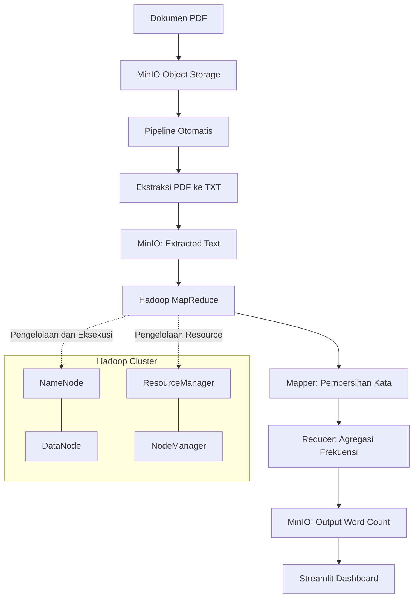

# Arsitektur Sistem SIBI Word Frequency

## 1. Gambaran Umum

SIBI Word Frequency merupakan proyek Big Data yang memproses dokumen PDF untuk menghasilkan analisis frekuensi kata. Sistem ini menggunakan Hadoop MapReduce untuk pemrosesan terdistribusi dan MinIO sebagai penyimpanan objek yang kompatibel dengan S3.

Sistem terdiri dari lima layanan utama yang dijalankan menggunakan Docker Compose, yaitu NameNode, DataNode, ResourceManager, NodeManager, dan MinIO.

## 2. Diagram Arsitektur



## 3. Komponen Sistem

| Komponen | Fungsi |
|---|---|
| NameNode | Mengelola metadata dan namespace HDFS. |
| DataNode | Menyimpan blok data HDFS. |
| ResourceManager | Mengelola alokasi resource dan penjadwalan aplikasi YARN. |
| NodeManager | Menjalankan dan mengelola container pada node komputasi. |
| MinIO | Menyimpan dokumen PDF, teks hasil ekstraksi, dan output pemrosesan. |
| Pipeline Otomatis | Memeriksa dokumen baru, mengekstrak teks, dan menjalankan job MapReduce. |
| Hadoop MapReduce | Memproses teks untuk menghitung frekuensi kata. |
| Streamlit Dashboard | Menampilkan hasil analisis frekuensi kata secara visual. |

## 4. Alur Pemrosesan Data

1. Dokumen PDF diunggah ke bucket MinIO `sibi-books`.
2. Pipeline otomatis memeriksa keberadaan dokumen baru.
3. Pipeline mengunduh PDF dan mengekstrak teks menggunakan PyMuPDF.
4. Hasil ekstraksi disimpan kembali ke MinIO pada prefix `extracted/`.
5. Hadoop Streaming menjalankan proses MapReduce dengan input dari MinIO.
6. Mapper membersihkan teks, mengubah kata menjadi huruf kecil, dan menghapus stopword bahasa Indonesia.
7. Reducer mengagregasi jumlah kemunculan setiap kata.
8. Hasil pemrosesan disimpan di MinIO pada prefix `output/`.
9. Dashboard Streamlit membaca hasil dan menyajikannya kepada pengguna.

## 5. Penyimpanan Data

MinIO menggunakan bucket `sibi-books` dengan struktur objek sebagai berikut:

```text
sibi-books/
├── dokumen.pdf
├── extracted/
│   └── dokumen.txt
└── output/
    └── wordcount_<nama_dokumen>_clean_v1/
```

Nama folder output dapat berbeda sesuai nama dokumen yang diproses.

## 6. Jaringan dan Komunikasi

Semua layanan Docker Compose terhubung melalui jaringan bridge `sibi-network`.

Layanan Hadoop mengakses MinIO melalui endpoint internal Docker:

```text
http://minio:9000
```

Dari host, MinIO dapat diakses melalui:

- API: `http://localhost:9002`
- Console: `http://localhost:9003`

## 7. Persistensi Data

Docker Compose menggunakan tiga named volume:

| Volume | Fungsi |
|---|---|
| `namenode_data` | Menyimpan data NameNode. |
| `datanode_data` | Menyimpan data DataNode. |
| `minio_data` | Menyimpan data objek MinIO. |

Named volume membantu mempertahankan data ketika container dihentikan atau dibuat ulang, selama volume tidak dihapus.

## 8. Batasan Arsitektur

- Pipeline saat ini menggunakan polling untuk mendeteksi dokumen baru, bukan streaming event secara real-time.
- Pemrosesan MapReduce berorientasi pada batch processing.
- MinIO berfungsi sebagai object storage, bukan pengganti penuh arsitektur HDFS.
- Dashboard bergantung pada ketersediaan output hasil pemrosesan.
- Jumlah container dan batas memori disesuaikan dengan keterbatasan sumber daya komputasi lokal.

## 9. Kesimpulan

Arsitektur SIBI Word Frequency mengintegrasikan object storage, Hadoop MapReduce, orkestrasi container, pipeline otomatis, dan dashboard visual. Integrasi ini mendukung alur pemrosesan dokumen dari PDF hingga hasil analisis frekuensi kata yang dapat digunakan untuk eksplorasi data.
